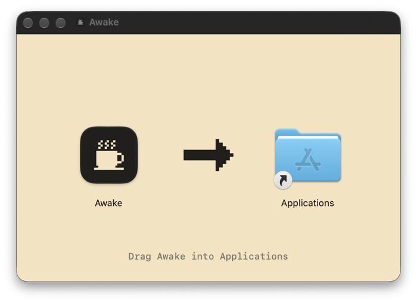

<p align="center">
  
</p>

<h1 align="center">Awake</h1>

<p align="center">A tiny native macOS menu bar app that keeps your Mac awake.<br>One click. No windows, no Dock icon, ~70 lines of Swift.</p>

## Features

- **One-click toggle** in the menu bar: a filled cup means awake, an outlined cup means normal sleep
- **Remembers** whether it was on or off and restores it the next time it starts
- **Opens at login**; turn that off with right-click → *Open at Login*
- **Featherweight**: a 92 KB native app (a 52 KB download) using about 12 MB of RAM, with no Electron and no dependencies
- Uses the same macOS power API as `caffeinate`, so the Mac and the display stay awake while it's on, and quitting always lets the Mac sleep again

## Awake vs. KeepingYouAwake vs. Caffeine

All three keep your Mac awake from the menu bar. Here is what each one costs you:

| | **Awake 1.0** | KeepingYouAwake 1.6.8 | Caffeine 1.1.4 |
| --- | --- | --- | --- |
| Download | **52 KB** | 4.5 MB (87× larger) | 828 KB (16× larger) |
| Size on disk | **92 KB**, 4 files | 7.2 MB, 310 files (78×) | 776 KB, 21 files (8×) |
| Memory, off | **12 MB** | 13 MB | 16 MB |
| Memory, on | **12 MB** | 13 MB + 2.3 MB helper process | not measured |
| CPU while idle | **0.006%** | 0.006% | 1.4–4.1% |
| CPU wake-ups per second | **0.006** | 0.011 | 10.2 |
| Extra processes | **none** | starts `caffeinate` while on | none |
| Bundled frameworks | **none** | Sparkle updater | none |

**Caffeine** redraws its menu bar icon about 10 times a second, even while it's switched off. That keeps a CPU core waking up all day and shows up in Activity Monitor's *Energy* tab. Awake only draws its icon when you click it.

**KeepingYouAwake** is just as quiet at rest as Awake. It's a 78× larger app, though: it ships an auto-updater framework, and it runs a second process (`caffeinate`) while it's on. Awake calls the macOS power API itself.

<details>
<summary>How these numbers were measured</summary>

On a MacBook with an Apple M4 and 16 GB of RAM, macOS 27.0, on November 15, 2026. Awake was built from this repo with `./release.sh`; the other two came from their official releases (Homebrew's `keepingyouawake` and `caffeine` casks). Each app was launched with default settings, left alone for 15 seconds, then watched for 3 minutes.

- **Download / size on disk**: the size of the release file, and the sum of all file sizes inside the `.app`
- **Memory**: `footprint -p <pid>`, the same number Activity Monitor shows as *Memory*
- **CPU and wake-ups**: `top -l 180 -s 1 -pid <pid> -stats cpu,idlew`, averaged over the 3 minutes
- **Helper process**: `pgrep -P <pid>`, with `footprint` again for its memory

The Caffeine CPU range comes from two separate 3-minute runs. Caffeine's *on* state could not be measured: its "activate on launch" setting didn't turn it on in this test.

</details>

## Install

1. Download the **Awake .dmg** from the [latest release](https://github.com/betterCallHex/awake/releases/latest)
2. Open it and drag **Awake** into **Applications**
3. Open Awake from Applications. A cup appears in your menu bar.



Works on macOS 13 Ventura or later, on Apple Silicon and Intel Macs.

### Homebrew

```sh
brew trust --tap betterCallHex/tap   # Homebrew 7+ only loads taps you trust
brew install --cask betterCallHex/tap/awake
```

**First launch (DMG or Homebrew):** Awake is free and not signed with a paid Apple Developer ID, so macOS will say it *"could not verify Awake"*. Click **Done**, then go to **System Settings → Privacy & Security**, scroll down and click **Open Anyway** next to Awake. You only need to do this once.

Prefer the Terminal? This does the same thing:

```sh
xattr -dr com.apple.quarantine /Applications/Awake.app && open /Applications/Awake.app
```

### Build from source

Requires the Xcode Command Line Tools (`xcode-select --install`).

```sh
git clone https://github.com/betterCallHex/awake.git
cd awake
./install.sh
```

`install.sh` builds the app, installs it to `/Applications/Awake.app` and launches it. Run it again to update.
`./build.sh` only builds `Awake.app` in the project folder.

## Usage

| Action | Result |
| --- | --- |
| Click the cup | Toggle awake on/off |
| Right-click (or Ctrl-click) | Menu: *Open at Login*, *Quit Awake* |

Awake only blocks idle sleep. Closing the lid or choosing Apple menu → Sleep still puts the Mac to sleep.

## App icon

The icon is 16×16 pixel art drawn in code by [`scripts/make-icon.swift`](scripts/make-icon.swift). To change it, edit the `art` grid there (each `#` is one pixel), then rebuild `Resources/AppIcon.icns`. This needs [pngquant](https://pngquant.org) and [oxipng](https://github.com/oxipng/oxipng) (`brew install pngquant oxipng`). `make-icon.swift` draws each pixel size once, and `scripts/pack-icns.swift` stores the optimised PNGs as they are, where `iconutil` would re-encode them at twice the size:

```sh
mkdir -p /tmp/AppIcon
swift scripts/make-icon.swift /tmp/AppIcon
pngquant --quality 95-100 --speed 1 --force --ext .png /tmp/AppIcon/*.png
oxipng -o max -Z --strip all /tmp/AppIcon/*.png
swift scripts/pack-icns.swift /tmp/AppIcon Resources/AppIcon.icns
sips -z 512 512 /tmp/AppIcon/1024.png --out docs/icon.png
```

## Releasing

Publish a release on GitHub with a `v<version>` tag (for example `gh release create v1.1 --generate-notes`). The [Release workflow](.github/workflows/release.yml) then:

1. Stamps `<version>` into `Info.plist` and runs `./release.sh`, which builds a universal app and packages `dist/Awake-<version>.dmg` with [dmgbuild](https://github.com/dmgbuild/dmgbuild)
2. Attaches the DMG to the release
3. Updates `version` and `sha256` in `Casks/awake.rb` in [betterCallHex/homebrew-tap](https://github.com/betterCallHex/homebrew-tap), pushing with the `TAP_DEPLOY_KEY` deploy key

To build a DMG locally, run `./release.sh` (needs [uv](https://docs.astral.sh/uv/)).

The DMG window background is pixel art drawn by [`scripts/make-dmg-background.swift`](scripts/make-dmg-background.swift):

```sh
swift scripts/make-dmg-background.swift Resources/dmg-background.png 1
swift scripts/make-dmg-background.swift Resources/dmg-background@2x.png 2
oxipng -o max -Z --strip all Resources/dmg-background*.png
```
